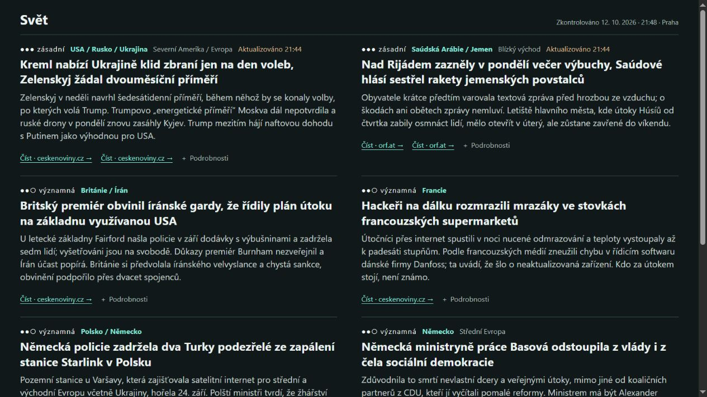

# Domácí IT lab: starý tablet jako server

Vyřazený tablet slouží jako malý domácí server. Průběžně sbírá podklady ze světového tisku a ukládá je do databáze. Z nich vzniká krátký přehled událostí s odkazy na zdroje, dostupný na **[mujlinux.cloud](https://mujlinux.cloud/)**.

Projekt propojuje provoz služeb, hledání závad v síti, kontrolu záloh a vydávání webové stránky.

## Jak funguje

1. **Sběr dat.** GDELT, veřejná databáze světového tisku, poskytuje dvě řady dávek po 15 minutách. Další podklady přicházejí z 22 RSS zdrojů; 19 z nich sleduje detektor nových témat, tři starší zpravodajská služba tabletu. Archiv za 11. října 2026 obsahuje 188 521 záznamů o článcích.
2. **Příprava přehledu.** Na počítači vznikne několik hlavních témat s odkazy na přečtené zdroje. U vydání se ukládají podklady a důvody výběru.
3. **Zveřejnění.** Stejná stránka se přenáší na tablet a na veřejný server. Kontrolní součty umožňují porovnat obsah po přenosu.
4. **Upozornění.** Tablet posílá přes Telegram kandidáty na nová témata, která stojí za kontrolu.

## Zařízení a jejich role

| Zařízení | Úloha | Technologie |
|---|---|---|
| Tablet Sony Xperia s Androidem | Sběr dat, databáze a domácí web | Termux (linuxové prostředí na Androidu), Python, SQLite, SSH |
| Pronajatý linuxový server | Veřejný přehled | Ubuntu, Nginx, HTTPS, Let's Encrypt, firewall |
| Počítač s Windows | Příprava vydání, zálohy a diagnostika | PowerShell, Python, Wi-Fi a USB |
| PlayStation Vita, kapesní herní konzole | Ovládání služeb tabletu a přehled jejich stavu | Lua |

## Případy z provozu

- **[Přenosy na tablet se zastavují](docs/incident-wifi.md):** porovnání stejného souboru na PC a tabletu, potom přes Wi-Fi a USB. Úspěšný USB přenos poskytl záložní cestu pro větší data.
- **[Záchrana denní zálohy](docs/backup.md):** obnovený archiv má 188 521 záznamů a 192 ze 192 očekávaných dávek; prošel kontrolou součtů, rozbalení i databáze.
- **[Postup vydávání](docs/process.md):** cesta od podkladů přes výběr a kontrolu zdrojů až k veřejné stránce.

## Metoda a technické ukázky

- [Jak vzniká přehled Svět](docs/methodology.md): výběr událostí, práce se zdroji, časy a hranice pokrytí.
- [Veřejný web](docs/web.md): oddělení dat a stránky, HTTPS a ověření přenosu.
- [Ověření archivu](scripts/verify_archive.py): spustitelný Python skript pro kontrolu uložené zálohy; [skutečný výsledek](examples/archive-verification.json).
- [Dvě SQL kontroly](examples/coverage.sql): úplnost dávek a zastoupení jazyků.

## Co projekt zahrnuje

Diagnostiku sítí a přenosů, správu služeb přes SSH, webový server a certifikáty, obnovu databáze ze zálohy, SQL a testování chybějících dat i opakovaných upozornění.

## Další rozvoj

Stabilita tabletu při dlouhém běhu, přenosy po Wi-Fi a přesnější upozornění na telefon.
